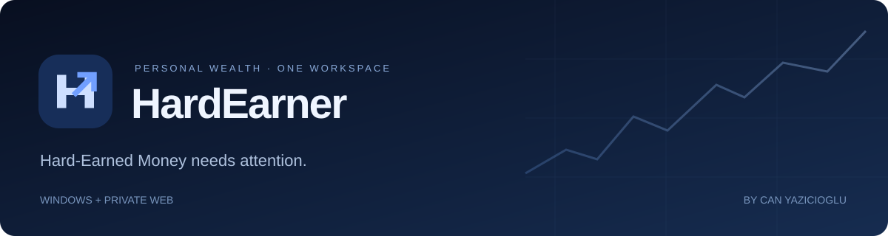
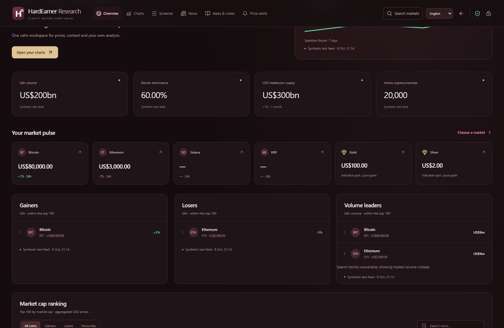
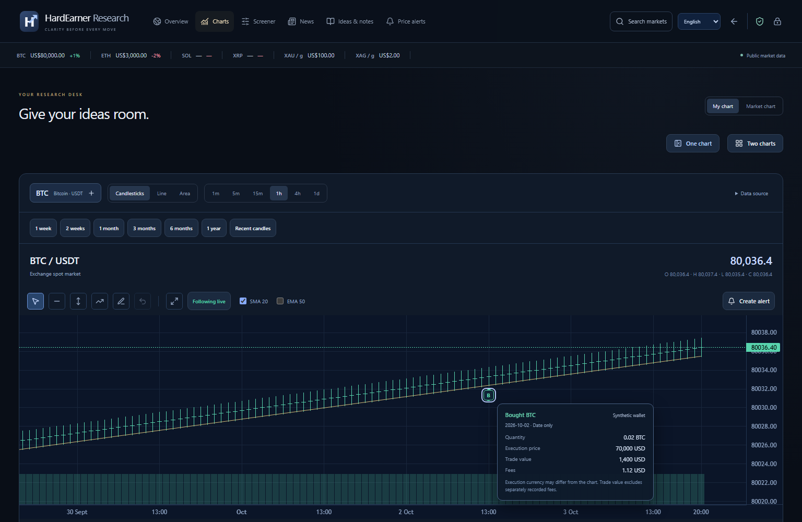
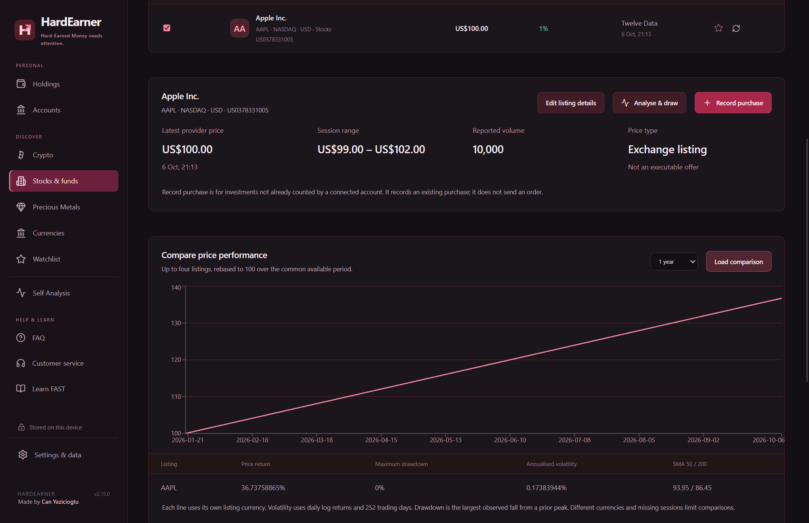
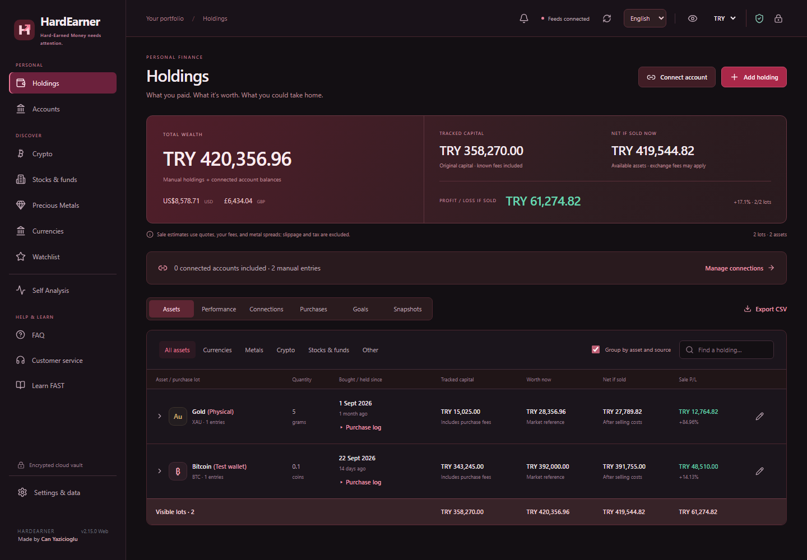
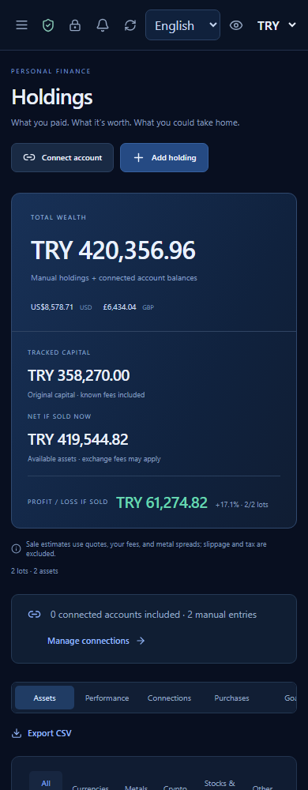

<p align="center"></p>

<p align="center">
  <a href="https://github.com/can-yazicioglu/HardEarner/actions/workflows/ci.yml"></a>
  
  
  
  
</p>

<p align="center"><b>Your money lives in different places. Understanding it should happen in one.</b></p>
<p align="center">A calm, navy-blue workspace for holdings, connected balances, purchase history and market analysis.<br/>Built by <a href="https://github.com/can-yazicioglu">Can Yazicioglu</a> for Windows and the private web.</p>

<p align="center"><a href="#inside-hardearner">Features</a> · <a href="#a-closer-look">Screenshots</a> · <a href="#run-locally">Run locally</a> · <a href="docs/architecture.md">Architecture</a> · <a href="docs/integrations.md">Integrations</a> · <a href="docs/roadmap.md">Roadmap</a></p>

## The idea

Savings rarely sit in one account. There may be Bitcoin on an exchange, cash in a bank, stocks with a broker and gold at home. HardEarner brings supported accounts and manual holdings into one view, with the source of each asset kept visible.

The goal is to understand **what you own, what it cost, where it is and how it is changing** without turning the interface into a crowded trading terminal.

This repository contains the Windows application and private website together. They share the same interface and accounting core; the web adds browser storage, encrypted cloud sync and an invitation gate.

## Inside HardEarner

| Workspace | What it does |
| --- | --- |
| **Holdings** | Combines physical assets, manual purchases and included connected accounts; values the portfolio in TRY, USD, GBP and EUR. |
| **Purchase history** | Shows dated lots, known costs, purchase and conversion evidence, fees and sale estimates. Supported transfers preserve cost provenance when matching evidence exists. Missing history stays explicitly incomplete. |
| **Performance** | Daily portfolio and asset logs, fee and tax records, and favourites that include held assets. Tracking starts from available evidence; it does not invent a complete historical portfolio. |
| **HardEarner Research** | A dedicated window with a market overview, rankings, dominance, TVL, heatmap, news and screeners. Personal charts retain streamed crypto candles, four metals, exact trade popups, drawings, notes and alerts. |
| **Stocks, ETFs & funds** | Instrument search, watchlists, comparisons, listing metadata and source-labelled market data, plus supported read-only investment account access. |
| **Private workspace** | App lock, encrypted storage, backups, recovery controls and separate web vaults per invited user. |
| **Learn FAST** | In-app walkthroughs and FAQ covering purchases, connections, cost gaps, analysis, alerts and vault recovery. |

The default language is Turkish and the default display currency is TRY. English, Spanish, Russian, French and German can also be selected; some provider content and newer guidance use English fallbacks.

## A closer look

These are captures of the actual application running with **synthetic test data**, not personal financial records or design mockups.

### A dedicated research desk





### Investments in the same workspace



<details>
<summary><b>Holdings and a phone-sized view</b></summary>



<p align="center"></p>

</details>

## Connections, with clear boundaries

Read-only connectors cover supported exchange wallets, Trading 212 Invest / Stocks ISA, Monzo and Starling personal developer access, and selected public blockchain addresses. Coverage differs by provider: a balance connection does not automatically supply purchase history.

**HardEarner currently tracks and analyses money. It does not place trades, make payments or withdraw funds.** BUY and SELL alerts are notifications. Broad bank connectivity, including Lloyds and İşbank, is not a live feature.

See the [integration matrix](docs/integrations.md) for wallet scope, history coverage and platform restrictions.

## Run locally

Install **Node.js 24** (including npm) and Git, then use a terminal:

```sh
git clone https://github.com/can-yazicioglu/HardEarner.git
cd HardEarner
npm run setup
npm run build
```

Repository access is required because the source is private. Dependencies are installed from the two committed lockfiles.

**Windows desktop**

```sh
npm run start:desktop
```

The development launcher uses a separate `.artifacts/dev-profile` directory. It does not open the installed Store app's financial records. Distribution and signing are separate from running source; see [deployment](docs/deployment.md).

**Local web preview — Windows, Mac or Linux**

```sh
npm run demo:web
```

Open **http://127.0.0.1:8794**. This is a loopback-only test harness with a synthetic identity and temporary, in-memory storage. Use a throwaway vault password and sample holdings. **Do not enter real API keys or financial records.** Restarting the server clears its vaults. Real private hosting uses verified Cloudflare Access and durable encrypted storage instead.

Detailed [development commands](docs/development.md) and [private deployment instructions](docs/deployment.md) are included.

## One codebase, two runtimes

```text
HardEarner/
├── desktop/
│   ├── src/           React interface shared with the web
│   ├── electron/      Accounting, providers, charts, native storage and IPC
│   ├── tests/         Unit tests and isolated Electron UI checks
│   └── store/         Store asset generator and identity template
├── web/
│   ├── client/        Browser platform adapter and encrypted vault
│   ├── server/        Cloudflare Access, provider relay and Durable Objects
│   ├── shared/        Vault envelope and validation
│   └── tests/         Worker, vault, Chromium and WebKit checks
├── docs/              Architecture, integration scope and development guide
└── .github/workflows/ Reproducible builds and fixture-based tests
```

| Layer | Technology |
| --- | --- |
| Interface | React 19, Lucide, Recharts, Lightweight Charts |
| Windows | Electron, isolated preload API, Windows-backed encrypted storage |
| Private web | Cloudflare Workers, SQLite Durable Objects, Cloudflare Access |
| Web vault | Web Crypto, AES-256-GCM, PBKDF2-SHA-256 with 600,000 iterations |
| Tooling | Node.js 24, esbuild, Node test runner, Playwright |

The [architecture guide](docs/architecture.md) explains the shared code and trust boundaries. [Research sources and limitations](docs/research.md) document chart units, refresh rates and the isolated third-party widgets.

## Verification

```sh
npm test
node desktop/node_modules/playwright/cli.js install chromium webkit
npm run test:web-ui
```

- **212 unit/integration tests** across the shared desktop core and web services.
- **Eight web UI runs** across Chromium and WebKit, including vault sync, conflicting saves, recovery, investments, drawings and streamed chart updates.
- Responsive checks cover **11 portfolio routes and six Research sections at four widths**, from phone to desktop.
- Optional Windows Electron tests cover isolated profiles, restart persistence and the desktop interface: `npm run test:desktop-ui`.

CI builds both targets on Windows and Linux, then runs the web UI checks on Linux. Provider responses are fixtures; passing these tests is not a claim that every live financial account or API is available in every region.

## Private preview

- The [private website](https://private.hardearner.com) requires an invitation and a personal vault password.
- Windows Store distribution also has its own invited audience. GitHub access does not grant app access.
- Web browsers using the same invited account share a vault. **The installed Windows app currently keeps separate data.**
- Web price alerts require the page to remain visible, online and unlocked. Desktop alerts can continue in the Windows tray while the PC is awake and online.
- Read-only account keys are encrypted at rest. The web relay temporarily receives decrypted credentials to query the selected provider; see [security](SECURITY.md).

## Where it is going

The longer-term vision is a complete financial management workspace. The immediate priorities are reliable cost provenance, broader verified account coverage, consistent data across devices and a clear experience for first-time users.

See the [roadmap](docs/roadmap.md). Payment initiation and trading would require separate provider support, controls and approvals; they are not implied by today's connectors.

---

**Made by Can Yazicioglu.** Private source, all rights reserved. Third-party components retain their own licenses; see [LICENSE](LICENSE). Charting by [TradingView Lightweight Charts](https://github.com/tradingview/lightweight-charts).
