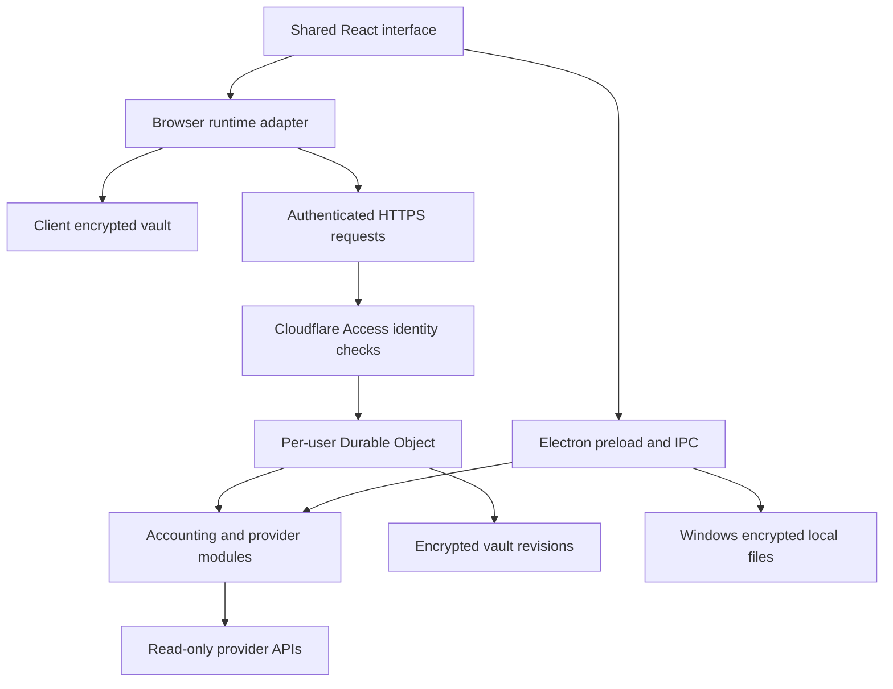

# Architecture

HardEarner is one product with a shared React interface and accounting core, adapted to two runtimes. Desktop and private web source version: **2.16.1**.

## Shared product logic

`desktop/src/` contains Holdings, Accounts, Self Analysis, investments, help and the design system. `desktop/electron/` includes provider adapters, ledger reconciliation, quote logic, cost calculations and validation.

`web/build.cjs` imports these modules and supplies browser/server storage and platform adapters. It also replaces native-only guidance and controls. Build-time checks deliberately fail when some expected desktop UI structures change, so web behaviour is reviewed alongside desktop edits.

The repository keeps dependencies in `desktop/node_modules` and `web/node_modules`. This layout is intentional: the web build resolves shared desktop dependencies directly. Run the root setup script rather than introducing hoisted workspaces without updating the resolvers.

## Desktop

Electron exposes a restricted preload API to a sandboxed renderer; Node integration is disabled. The main process handles provider access, persistence, notifications and chart streaming. Windows-backed `safeStorage` encrypts local files. The app lock gates access inside the running app; the operating-system encryption boundary remains relevant.

The installed app retains its legacy `Aurel` data directory for continuity. The repository's development launcher explicitly redirects to `.artifacts/dev-profile`; UI tests create separate temporary profiles. Do not point tests at a real application profile.

## Private web

1. Cloudflare Access authenticates an invited email.
2. The Worker verifies the signed token's issuer, audience, expiry and required claims, then checks its own email allowlist. The same gate applies to static assets and API routes.
3. Each email maps to a separate Durable Object. The browser derives an AES-256-GCM key using PBKDF2-SHA-256, a random salt and 600,000 iterations. The password is not transmitted.
4. Encrypted vault envelopes are stored with revision checks. Conflicting updates are rejected, and previous encrypted revisions support recovery. IndexedDB retains encrypted pending changes.
5. To sync an account, the unlocked browser submits the required read-only credentials over HTTPS. The relay uses plaintext credentials transiently to call the selected provider. They are not deliberately persisted or logged in plaintext by the application.

This is encrypted storage with a trusted request relay. It is not a design in which the server can never see provider credentials. See [SECURITY.md](../SECURITY.md).

## Data and estimates

Current value, known cost, sale estimates and realised history are different quantities. The accounting modules preserve this distinction and retain evidence for provenance. A balance without supported history cannot establish its purchase date or original cost. Gaps remain visible rather than being replaced with a fabricated zero cost.

Matched transfers can carry cost between connected sources. Transfers without an established origin may start at an explicitly identified observed USD value; that is an estimate, not recovered historical cost or tax advice. Fees, conversion legs, partial sales and returned history completeness all affect the result.

Quote freshness and venue matter. Crypto charts can use live public trade streams; metals use provider sampling. Securities depend on coverage, exchange entitlement and delay. A sampled or delayed quote is not presented as a trade-by-trade exchange feed.

## Deliberate platform differences

| Capability | Windows | Private web |
| --- | --- | --- |
| Core UI and accounting | Shared | Shared |
| Persistence | Local encrypted files | Browser-encrypted cloud vault |
| Sync between browsers | Not applicable | Same invited identity and vault password |
| Desktop-to-web vault sync | Not implemented | Not implemented |
| Alerts after closing the window | Tray, awake and online PC | No background alert service |
| Binance TR account connection | Present | New connections hidden due to cloud-provider access restrictions |
| OS integration | Windows notifications and tray | Browser-dependent notifications and home-screen installation |

## Verification boundaries

The local server under `web/tests/` substitutes a synthetic identity and an in-memory platform. It is only a test fixture, is bound to loopback and is never part of the deployed Worker entry point. UI suites inject synthetic provider responses. Real credentials, local profiles and deployment identities are intentionally excluded from Git.

## Research Lab

The shared research catalogue, data adapters, calculations, layout validation and UI live under desktop/electron/research-* and desktop/src/research-*. Both runtimes use these modules. Public requests are bounded and coalesced; personal-provider requests use encrypted credentials and the existing authenticated relay. The library distinguishes available data from configured-but-unverified and unimplemented source coverage.

The browser Research handoff validates exact origin/window/token, identity and vault salt, then transfers a non-extractable CryptoKey through MessageChannel in memory. Explicit lock and password rotation broadcast only an account-scoped lock signal. No password or key is persisted for this convenience. See [Research Lab](research-lab.md) for the complete boundary and remaining work.
